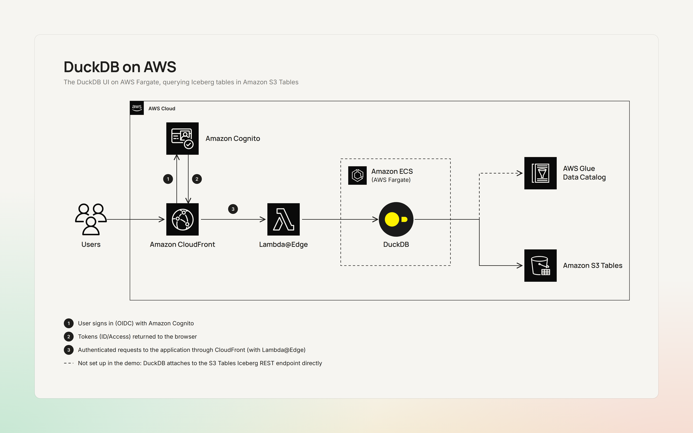
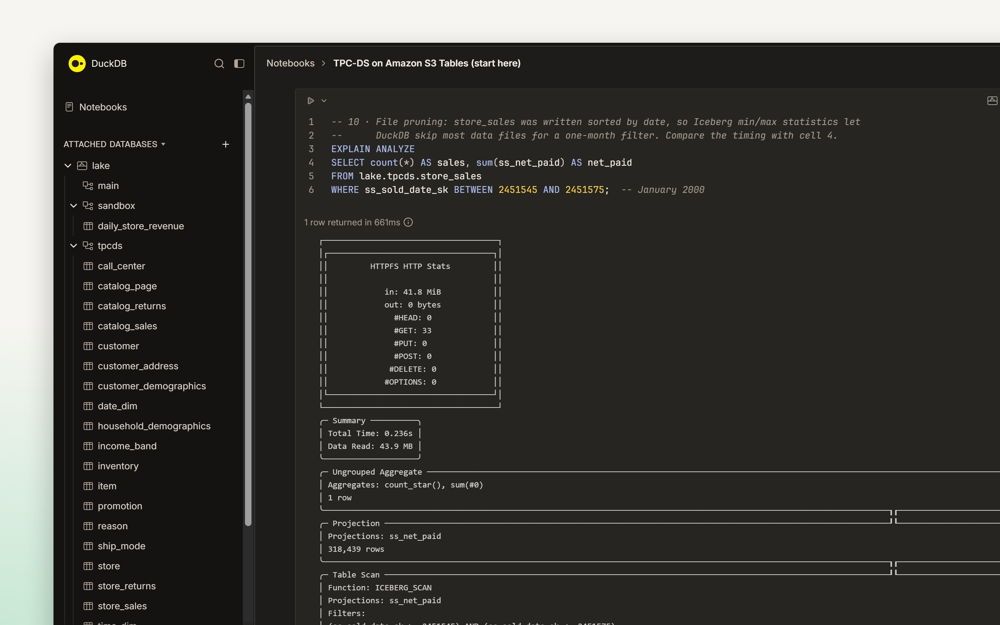

In August, [AWS acquired DuckLabs](https://www.aboutamazon.com/news/company-news/aws-ducklabs), the company behind DuckDB. As the DuckDB team explains in [DuckLabs to Join AWS](https://duckdb.org/2026/08/26/ducklabs-to-join-aws), DuckDB itself stays open source, governed by the independent DuckDB Foundation.

In this post, we look at running DuckDB on AWS today: DuckDB reading and writing Iceberg tables in [Amazon S3 Tables](https://aws.amazon.com/s3/features/tables/), with the [DuckDB UI](https://duckdb.org/docs/stable/core_extensions/ui) as the SQL console.

To do that, we use a demo that [Angel Conde](https://www.linkedin.com/in/acmanjon/) from AWS built for last week's [Mure Forward: DuckDB + Apache Iceberg](https://luma.com/b18mbzst). Check out the code on [GitHub](https://github.com/muredata/mure-examples/tree/main/duckdb-aws-demo).

*Note: [last update: 2026-11-24] [AWS re:Invent](https://aws.amazon.com/events/reinvent/) runs from November 30 to December 4, 2026. New DuckDB announcements there may change parts of this setup. We'll update this post if they do.*

## Setup

- **Data**: TPC-DS at scale factor 10 (24 tables, about 10 GB raw), generated with DuckDB and stored as Iceberg tables in an S3 table bucket.
- **Engine**: DuckDB 2.0 and the DuckDB UI on AWS Fargate (ARM64), in private subnets, attached to the table bucket through the S3 Tables Iceberg REST endpoint.
- **Access**: CloudFront in front, an AWS WAF IP allow list, and a Cognito sign-in enforced by Lambda@Edge.
- **Notebook**: a ready-made notebook in the UI with Iceberg metadata queries, TPC-DS queries, a `MERGE` and time travel.

Everything is deployed with Terraform, and every step runs through one CLI: `uv run duckdemo deploy`, `load-tpcds`, `scale 0`, `destroy`.



## S3 Tables

S3 Tables is S3 with a built-in Iceberg catalog and table maintenance. Compaction, snapshot expiry and removal of unreferenced files run on their own, so you don't need a Spark job to keep the tables healthy. DuckDB supports the S3 Tables Iceberg REST endpoint natively:

```sql
CREATE SECRET task_role (TYPE s3, PROVIDER credential_chain, REGION 'eu-west-1', REFRESH auto);

ATTACH 'arn:aws:s3tables:eu-west-1:<account>:bucket/<bucket>' AS lake
    (TYPE iceberg, ENDPOINT_TYPE s3_tables);
```

DuckDB authenticates with the Fargate task's IAM role, so there are no access keys in the container. After the `ATTACH`, the table bucket shows up as a database called `lake`, and you query Iceberg tables like any other table: `SELECT * FROM lake.tpcds.store_sales`.

## Loading TPC-DS data

The demo uses [TPC-DS](https://www.tpc.org/tpcds/) as sample data. The loader runs once as a separate, larger Fargate task. It generates the data with `CALL dsdgen(sf = 10)` into a local DuckDB file, then copies each table into S3 Tables and checks the row counts.

- **Fact tables sorted by date.** `store_sales` and the other fact tables are written sorted by their date key, so min/max statistics let DuckDB skip data on date filters. In our test run, a one-month filter on `store_sales` read 2 of its 4 files and 43.9 MB, and scanned 318,439 rows.
- **Iceberg V2 by default.** Amazon Athena can read V2 but not V3. To write V3, run the loader with `--format-version 3`.
- **256 MB target files, ZSTD compression.** Both set as table properties.

In our test run, the loader took 73 seconds for all 24 tables, data generation included, and about 2 minutes counting the Fargate task start-up. `store_sales` (28.8 million rows) was written in 5 seconds, as 4 Parquet files of about 290 MB each, 1.15 GB in total.



## Exposing the DuckDB UI

The DuckDB UI is designed to run on `localhost`: it binds to loopback, rejects cross-origin requests, and has no authentication of its own. To deploy it on AWS, the demo keeps as much of that design as it can and adds layers around it:

```
Browser
  → CloudFront + WAF (IP allow list, rate limit, AWS managed rules)
  → Lambda@Edge (Cognito sign-in, fails closed)
  → CloudFront VPC origin → internal ALB (no public address)
  → Fargate task: HAProxy sidecar → DuckDB UI on 127.0.0.1
```

- **The UI stays on loopback.** An HAProxy sidecar in the same task is the only way in, and it keeps the UI's origin checks.
- **Two gates, no public origin.** WAF allows only listed IPs, Lambda@Edge requires a Cognito sign-in, and the ALB behind CloudFront is internal.
- **Reads everywhere, writes in one place.** The UI can read every table but only create or change tables in a `sandbox` namespace.

The DuckDB UI frontend is served by MotherDuck from `ui.duckdb.org` at runtime. So the task needs egress to that domain through a NAT gateway. DNS Firewall resolves only AWS names and `ui.duckdb.org`.

## Try it

You need an AWS account, a region with S3 Tables and CloudFront VPC origins, and uv, Terraform, Docker and Node.js locally:

```bash
git clone https://github.com/muredata/mure-examples.git
cd mure-examples/duckdb-aws-demo
cp terraform/terraform.tfvars.example terraform/terraform.tfvars   # Region, email, allowed IPs
uv run duckdemo deploy        # creates the infrastructure
uv run duckdemo load-tpcds    # generates and loads SF10
uv run duckdemo destroy       # removes everything
```

Then open the URL, sign in, and start with the notebook "TPC-DS on Amazon S3 Tables (start here)".

## Additional notes

This is a demo. Some considerations:

- **Anyone who signs in can run any SQL** with the task role: read every TPC-DS table, write in `sandbox`, read local files in the container. Give it to trusted users only, or put a governed SQL layer in front.
- **DuckDB is not the only engine.** The tables are plain Iceberg, so Spark, PyIceberg and other Iceberg clients can use the same S3 Tables endpoint. Athena, Redshift and EMR can query them too once the table bucket is [integrated with the AWS Glue Data Catalog](https://docs.aws.amazon.com/AmazonS3/latest/userguide/s3-tables-access.html), which the demo doesn't set up. DuckDB also runs as a managed option: [SageMaker Unified Studio notebooks](https://docs.aws.amazon.com/sagemaker-unified-studio/latest/userguide/notebooks-duckdb.html) include DuckDB 2.0, can attach S3 Tables and the Glue Data Catalog, and, in preview, run DuckDB SQL in Athena workgroups that use the DuckDB engine.
- **No performance testing.** We ran the notebook queries; this is not a TPC-DS benchmark.
