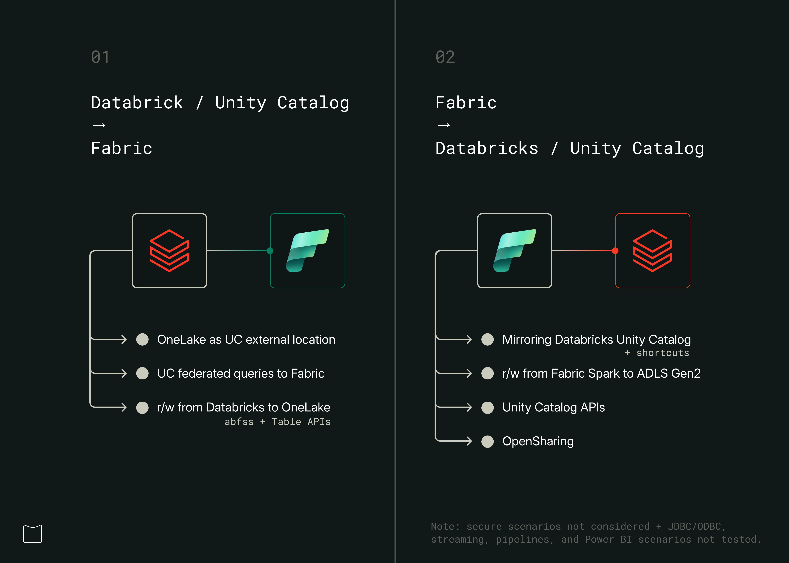
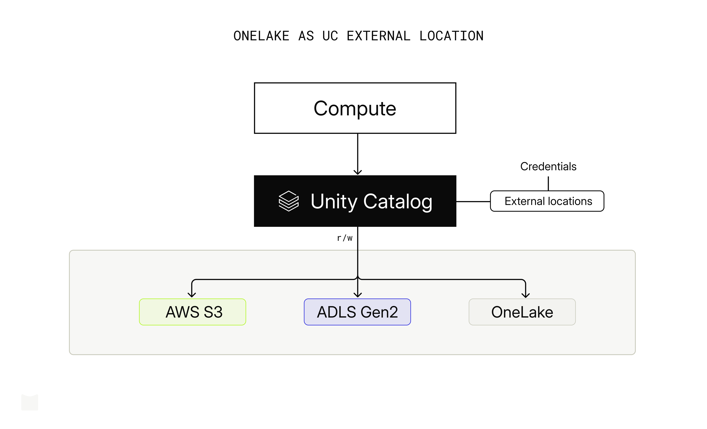
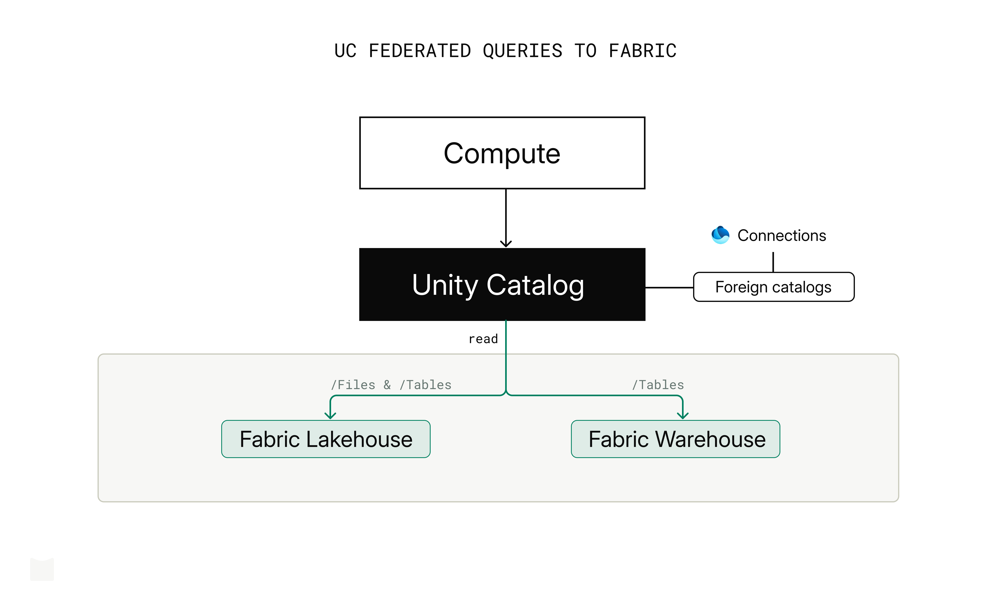
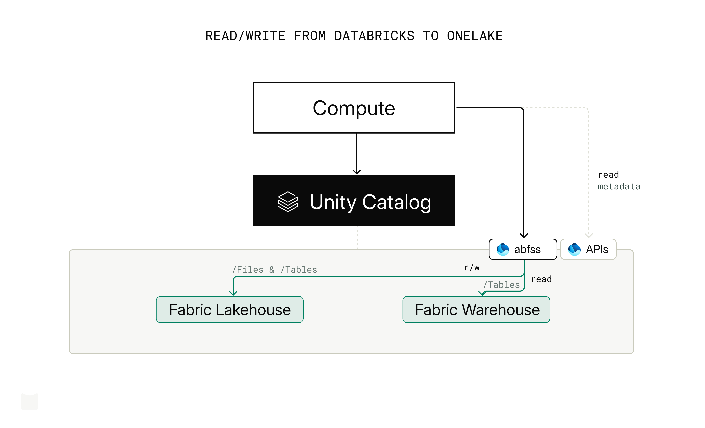
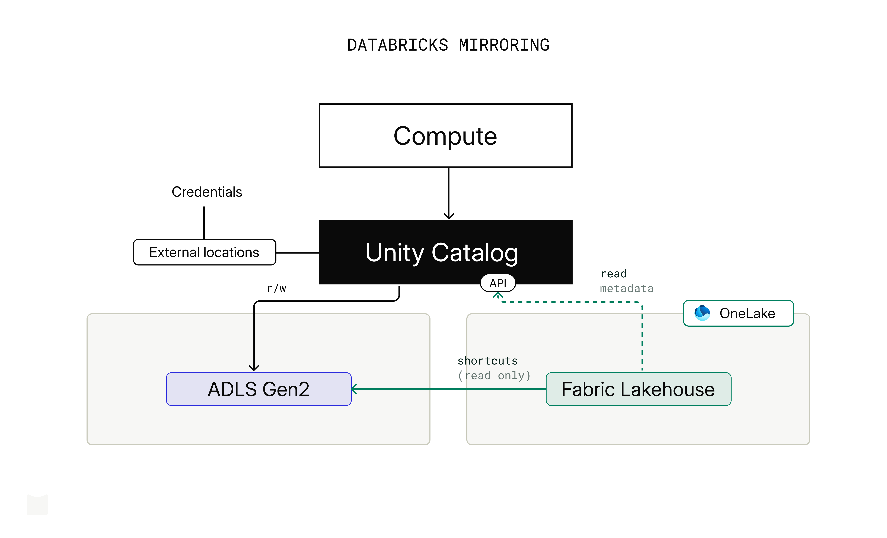
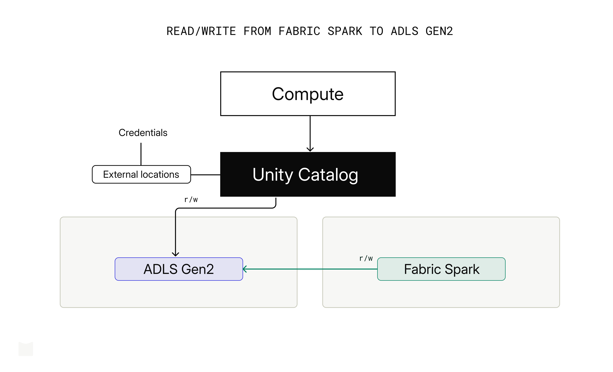
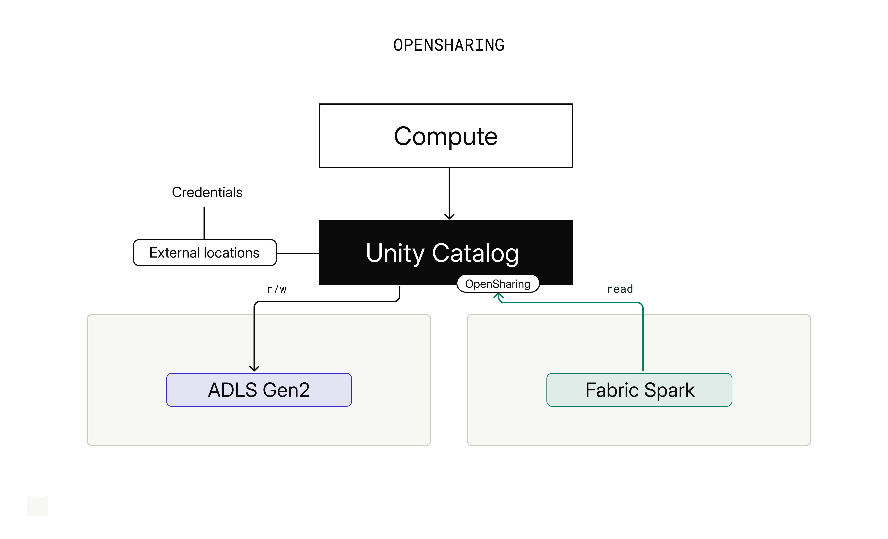

Many data teams today find themselves operating across multiple data platforms and query engines: Microsoft Fabric, Databricks, Snowflake, BigQuery and MotherDuck/DuckDB among them. This is not unusual. Platform and compute engine decisions rarely happen in a vacuum: requirements, team preferences and human + agent skills, licensing agreements, and timing all play a role.

Each platform can offer multiple *query engines* (e.g. Spark, a warehouse engine), different *ingestion* and orchestration options (e.g. dbt integration, in-house low code), a *catalog* with federation and access controls, access to multiple *storage* layers and support for *table formats* (e.g. Delta Lake, Iceberg), and in-house (e.g. Copilot, Genie, Cortex) plus external (e.g. Skills, MCP, CLI) *agentic tools*.

Focusing on Fabric and Azure Databricks, the question we hear often from clients is: **how do you actually connect Microsoft Fabric and Azure Databricks Unity Catalog (UC)? What are the integration options?**

Integration options can be broken down by direction:

1. **Unity Catalog → Fabric**: accessing and writing to OneLake from Databricks, running federated queries against Fabric endpoints.

    - Can I register OneLake paths as external locations in UC?
    - Can I run federated queries against a Fabric Lakehouse/SQL endpoint or Warehouse?
    - Can I write from UC-enabled clusters to OneLake?


2. **Fabric → Unity Catalog**: accessing and writing to Unity Catalog schemas and tables from within Fabric.

   - Can I sync UC tables into OneLake?
   - Can I write from Fabric back to UC?
   - Can I query UC tables directly from Fabric?

In this write-up, we'll explore each of these options in turn.

*Note: [last update: 2026-06-17] This article reflects an independent viewpoint, not the official stance of Microsoft or Databricks. It does not necessarily reflect product roadmaps or intentions, and not all options mentioned may be available in the future.*



# 1. Using OneLake from Databricks and Unity Catalog

Databricks UC offers several options to connect to and leverage cloud object stores (e.g. AWS S3, ADLS Gen2) and to run federated queries against external systems.

## 1.1. OneLake as UC external location

OneLake can be registered as a UC external location — either via UI or CLI. This means users can use OneLake as default storage for Unity Catalog managed Delta tables (external tables not supported for now). Fabric announced a new item type 'Azure Databricks Storage' for that, but our tests also worked with schema and non-schema lakehouses, using the `/Files` section for writes.

See current limitations [here](https://learn.microsoft.com/en-us/azure/databricks/connect/unity-catalog/cloud-storage/external-locations-onelake).



**Note**: tested on SQL Warehouse (✓), Serverless (✓), all-purpose clusters (✓). An error was raised creating external tables pointing to OneLake: *"ErrorClass=INVALID_PARAMETER_VALUE.
PATH_BASED_ACCESS_NOT_SUPPORTED_FOR_FABRIC]"*

## 1.2. UC federated queries to Fabric

Users can run federated queries against tables in a Fabric Lakehouse or Warehouse using the [OneLake connector](https://learn.microsoft.com/en-us/azure/databricks/query-federation/onelake) with managed identity and service principal authentication. Only managed Delta Lake tables from Fabric Lakehouse and Warehouse are exposed within UC using the foreign catalog. The Lakehouse `/Files` section is exposed as a [UC volume](https://learn.microsoft.com/en-us/azure/databricks/volumes/).

- `{your_name}_catalog/{schema}/{managed_delta_tables}`: tables in schema-enabled or non-schema Lakehouse, or Warehouse. For non-schema Lakehouse, a default `dbo` schema is exposed.
- `{your_name}_catalog/onelake_folders/files`: UC volume exposing data at the Lakehouse `/Files` section. Lakehouse only, works with schema and non-schema lakehouses.

```sql
-- query /Files section (Lakehouse)
SELECT * FROM delta.`/Volumes/{cat}/onelake-folders/files/{path}/`

-- query managed Delta tables (Lakehouse)
SELECT * FROM `onelake-mi_catalog`.dbo.delta_manag1 LIMIT 2

-- query managed Delta tables (Warehouse)
SELECT * FROM `onelake-mi-wh_catalog`.dbo.delta_manag1 LIMIT 2
```

Current limitations include materialized views not being exposed, complex data types (arrays, maps, structs) not being supported, and more. See [all OneLake connector limitations](https://learn.microsoft.com/en-us/azure/databricks/query-federation/onelake).



**Note**: tested on SQL Warehouse (✓), Serverless (✓), all-purpose clusters (✓).

## 1.3. Read/write from Databricks to OneLake

### Using abfss

UC-enabled Databricks clusters can read and write directly to the `/Files` and `/Tables` sections of a Fabric Lakehouse (schema-enabled and non-schema lakehouses) through an `abfss` path. It effectively treats OneLake like any ADLS Gen2 account, bypassing Unity Catalog. Reading Warehouse tables using `abfss` path also works.

```python
# read from /Files (Lakehouse)
spark.read.format("delta").load(f"abfss://{workspace_name}@onelake.dfs.fabric.microsoft.com/{lakehouse_name}.Lakehouse/Files/{path}")

# read from /Tables (Lakehouse)
spark.read.format("delta").load(f"abfss://{workspace_name}@onelake.dfs.fabric.microsoft.com/{lakehouse_name}.Lakehouse/Tables/dbo/{table}")

# write to /Files (Lakehouse)
df.write.format("delta").mode("overwrite").save(f"abfss://{workspace_name}@onelake.dfs.fabric.microsoft.com/{lakehouse_name}.Lakehouse/Files/{path}")

# write to /Tables (Lakehouse)
df.write.format("delta").mode("overwrite").save(f"abfss://{workspace_name}@onelake.dfs.fabric.microsoft.com/{lakehouse_name}.Lakehouse/Tables/dbo/{table}")

# read from /Tables (Warehouse)
spark.read.format("delta").load(f"abfss://{workspace_name}@onelake.dfs.fabric.microsoft.com/{warehouse_name}.Warehouse/Tables/dbo/{table}")
```

**Note**: tested on SQL Warehouse (✗), Serverless (✗), all-purpose clusters (✓) using OAuth `spark.conf` with service principal authentication.



### Using OneLake Table API

The [OneLake Table API](https://learn.microsoft.com/en-us/fabric/onelake/table-apis/delta-table-apis-overview) is a metadata discovery API, not a data read/write mechanism. It is an OSS UC-compatible ([unitycatalog.io](https://unitycatalog.io/)) catalog discovery API providing metadata operations. The unitycatalog.io API currently supports (experimental) creating an external table, but the OneLake Table API only supports list and get-metadata operations, for both Delta Lake and Iceberg.

# 2. Using Unity Catalog from Fabric

Fabric offers several options for accessing Unity Catalog tables from within Fabric, including Mirroring (with Shortcuts), read/write from Fabric Spark to ADLS Gen2, the Unity Catalog APIs, and OpenSharing.

## 2.1. Mirroring Databricks Unity Catalog

[Mirroring](https://learn.microsoft.com/en-us/fabric/mirroring/azure-databricks) creates a read-only, continuously replicated copy of Azure Databricks data in OneLake. UC managed and external Delta Lake tables can be mirrored to a Fabric Lakehouse/SQL endpoint. There is no separate data copy; UC mirroring uses read-only shortcuts under the hood.

See [current Mirroring limitations](https://learn.microsoft.com/en-us/fabric/mirroring/azure-databricks-limitations). You can also [publish a Unity Catalog catalog to Microsoft Fabric](https://learn.microsoft.com/en-us/azure/databricks/partners/bi/fabric-publish) directly; it creates read-only mirrored tables.



**Note**: tested with managed and external Delta Lake tables created on UC. Non-Delta external tables are excluded.

### Shortcuts

Shortcuts are OneLake objects that point to external storage locations, effectively symbolic links. If UC external locations point to [ADLS Gen2](https://learn.microsoft.com/en-us/fabric/onelake/create-adls-shortcut) (read/write), [AWS S3](https://learn.microsoft.com/en-us/fabric/onelake/create-s3-shortcut) (read only) or [GCS](https://learn.microsoft.com/en-us/fabric/onelake/create-gcs-shortcut) (read only), you can create shortcuts directly to those storage paths. Note that this approach completely bypasses all the security, permissions, and auditing you have set up in Unity Catalog.

## 2.2. Read/write from Fabric Spark to ADLS Gen2

If UC external locations point to ADLS Gen2, Fabric Spark can read/write those paths directly using `abfss` with service principal authentication — the same way Databricks reads OneLake. This bypasses Unity Catalog entirely (no governance, no auditing), so it carries the same caveat as Shortcuts.

Note that only managed Delta tables are synced to the Fabric SQL endpoint. Unmanaged or external tables written this way are queryable via Fabric Spark but not via the SQL endpoint.



**Note**: tested read/write with service principal (✓) over managed and external Delta tables created via UC.

## 2.3. Unity Catalog APIs

Unity Catalog exposes two API surfaces for external access: the [Unity REST API](https://learn.microsoft.com/en-us/azure/databricks/external-access/unity-rest) for Delta Lake clients, and the [Iceberg REST Catalog](https://learn.microsoft.com/en-us/azure/databricks/external-access/iceberg) for Apache Iceberg clients. Both are designed to allow external clients to create, read from, and write to UC managed and external tables.

[Unity Catalog external access overview](https://learn.microsoft.com/en-us/azure/databricks/external-access/) covers supported formats and access patterns for Unity Catalog objects.

After setting up the [Spark configuration to read and write to Unity Catalog managed and external Delta tables](https://learn.microsoft.com/en-us/azure/databricks/external-access/unity-rest) with [Fabric Spark runtime 2](https://learn.microsoft.com/en-us/fabric/data-engineering/runtime-2-0) (Spark 4.1) using PAT authentication, we were able to read UC managed and external tables, and create and write to external tables (ADLS Gen2) in UC from Fabric Spark.


**Note**: Writing to UC managed tables (with catalog commits enabled) from Fabric Spark failed with `java.lang.NoClassDefFoundError: io/unitycatalog/client/auth/TokenProvider`; we will retry in the near future.

## 2.4. OpenSharing

[OpenSharing](https://learn.microsoft.com/en-us/azure/databricks/delta-sharing/) (previously Delta Sharing) is an open protocol for secure data sharing with users on the same data platform (Databricks-to-Databricks) and other computing platforms (e.g. Databricks-to-Fabric). Users can share data from UC to an external recipient and read it from Fabric Spark.



In our test, after enabling OpenSharing in UC for a managed and an external Delta table, we uploaded the `config.share` to the `/Files` section of the Lakehouse, and added `delta-sharing-spark_2.13:4.1.0` as a library to the Spark session in Fabric Spark runtime 2 (Spark 4.1). We were able to read both tables by:

```
# read using OpenSharing
spark.read.format("deltaSharing").load("<lakehouse_path>/config.share#<share_name>.<schema>.<table>")
```

# Summary

Each integration path makes a different trade-off: the right choice depends on your governance requirements, compute constraints, and whether you need bidirectional access.

```
| Option | UC bypass | Managed tables | Ext. tables |
|--------|-----------|----------------|-------------|
| 1.1    | no        | r/w            | -           |
| 1.2    | no        | r              | -           |
| 1.3    | yes       | r/w            | r/w         |
| 2.1    | yes       | r              | r           |
| 2.1s   | yes       | r/w            | r/w         |
| 2.2    | yes       | r/w            | r/w         |
| 2.3    | no        | r              | r/w         |
| 2.4    | no        | r              | r           |
```

Table notes:

- 1.3: r/w applies to Lakehouse tables only; Warehouse supports read of managed tables.
- 2.1: marked as UC bypass because, although Mirroring authenticates via UC to obtain catalog information, it accesses data directly via storage shortcuts.
- 2.3: writing to managed Delta table with [catalog commits](https://learn.microsoft.com/en-us/azure/databricks/delta/catalog-commits) from Fabric failed. That's why write was not placed on the table.

Test scope notes:

- Public endpoints only; private endpoint scenarios (e.g. ADLS Gen2) not tested.
- JDBC/ODBC, Power BI, pipelines, streaming, and job triggering out of scope.
- UC and OneLake security policies not evaluated.
- Iceberg interoperability not tested.
- No performance or scalability testing.
- All tests done with Azure Databricks.
